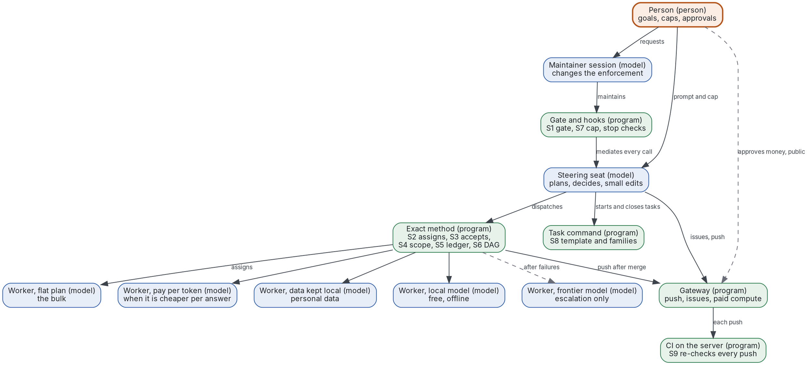

# The organisation of an agentic setup

Who does what in a setup that holds the nine practices of the [standard](standard.toml): one person, two model sessions, the programs that enforce, and the workers.

**Shape:** [figure](https://github.com/Tewf/reader-ergonomics-presentations/blob/master/shapes/figure.md)

**The person sets goals and limits, the steering seat plans and dispatches, programs assign, check and guard, and the workers do the bulk.**

## What the chart shows

- Person: goals, caps, approvals
- Maintainer session: changes the enforcement
- Steering seat: plans, decides, small edits
- Gate and hooks: S1 gate, S7 cap, stop checks
- Exact method: S2 assigns, S3 accepts, S4 scope, S5 ledger, S6 DAG
- Task command: S8 template and families
- Worker, flat plan: the bulk
- Worker, pay per token: when it is cheaper per answer
- Worker, data kept local: personal data
- Worker, local model: free, offline
- Worker, frontier model: escalation only
- Gateway: push, issues, paid compute
- CI on the server: S9 re-checks every push

Colours: a person in orange, a model in blue, a program in green; each box also names its kind.

An implementation fills each role with its own agents and programs.

Graphviz source

