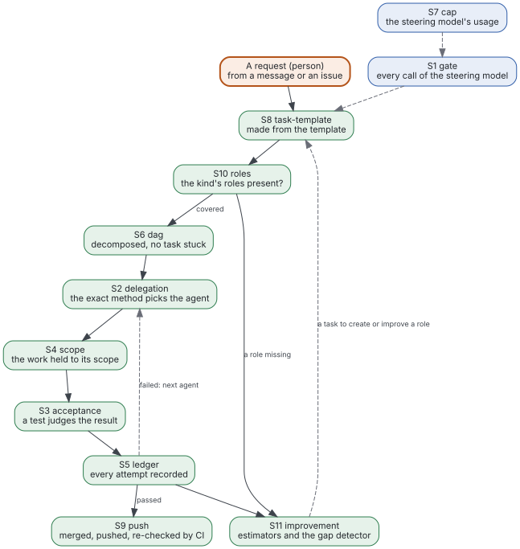
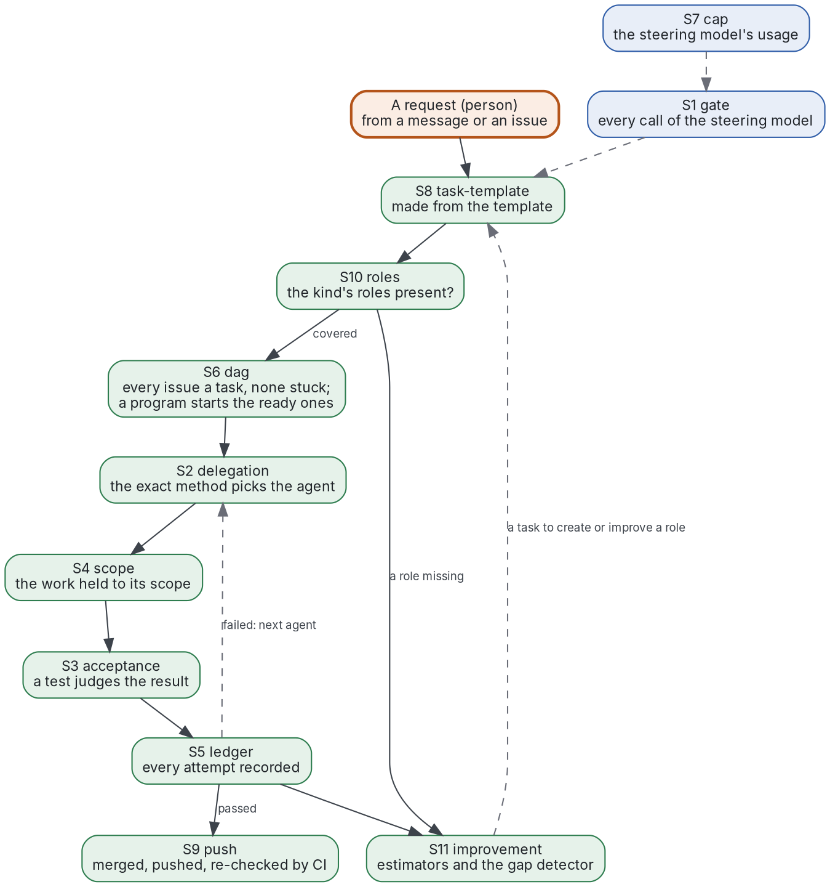

# The workflow of an agentic setup

How a request becomes finished work, and how the setup improves itself: every step is a practice of the
[standard](standard.toml), and every practice has a test in the implementation's map, so each part of the graph is
checked.

**Shape:** [figure](https://github.com/Tewf/reader-ergonomics-presentations/blob/master/shapes/figure.md)

**A task is made from the template, its roles are checked, the exact method assigns it, a test judges it, and its outcome feeds the improvement of the roles and of the workflow itself.**

## What the graph shows

- S8 task-template: every task starts from the template; a task built as a project follows the structure of a thesis (problem, scope, review, baseline, plan, trail).
- S10 roles: the kind of task names the roles that cover it; a program checks they are present, and a missing one goes to the improvement step.
- S6 dag: the work is decomposed into a graph of tasks, none stuck; every open issue is a task, and a program, not the steering model, starts each ready task that carries a check: a graph only a model drains stops when that model does.
- S2 delegation: the exact method picks the agent for each task.
- S4 scope: the work is held to the scope the task declared.
- S3 acceptance: a test the program runs judges the result.
- S5 ledger: every attempt is recorded; a failure goes to the next agent.
- S9 push: a passed task is merged, pushed and checked again on the server.
- S11 improvement: the estimators and the gap detector read the record; a gap opens a task to create or improve a role, a tool or the workflow.
- S1 gate and S7 cap: they watch every call of the steering model.

Colours: the person in orange, the steering model's guards in blue, the workflow's steps in green.

## Skills, tools, exact methods, roles

| Term | What it is | What it answers for |
|---|---|---|
| **skill** | a packaged procedure a model follows: instructions and examples | nothing measured: it is the heuristic |
| **tool** | a capability an agent calls: a program or a tool server | its own correctness, by its tests |
| **exact method** | a proven algorithm with its tests: an assignment, a schedule, a check | its proof, or its tests as the oracle |
| **role** | a skill extended: skills as the heuristic, tools, exact methods as the engine, inside a harness | how often it works, with its proof |
| **agent** | a model that runs a role on one task | the task's acceptance test |

## The graph's tests

- Every step is a practice of `standard.toml`, and every practice is a step: `checks/test_workflow.py` fails when they drift apart.
- Every practice has its test in the implementation's `agentic-setup.toml`, and `checks/instance.py` runs them: each part of the graph is checked on every push of the implementation.
- A change to the workflow is a change to this graph and to the standard, with its test, in the same commit.

Graphviz source

